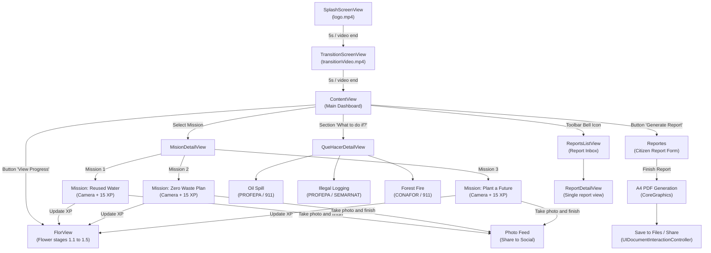

<div align="right">
  <a href="#version-en-espanol"></a>
  <a href="#english-version"></a>
</div>

<a id="version-en-espanol"></a>

# Bloom — Gamificación y Acción Ecológica Ciudadana

<p align="center">
  
  
  
  
  
  
</p>

---

## Índice

1. [Acerca del Proyecto](#acerca-del-proyecto)
2. [Características Principales](#características-principales)
3. [Mecánica de Gamificación (La Flor)](#mecánica-de-gamificación-la-flor)
4. [Prototipo Interactivo en Figma](#prototipo-interactivo-en-figma)
5. [Estructura del Proyecto y Código Fuente](#estructura-del-proyecto-y-código-fuente)
6. [Flujo de Navegación de la Aplicación](#flujo-de-navegación-de-la-aplicación)
7. [Stack Tecnológico y Frameworks](#stack-tecnológico-y-frameworks)
8. [Requisitos y Guía de Instalación](#requisitos-y-guía-de-instalación)
9. [Permisos y Configuración de Hardware](#permisos-y-configuración-de-hardware)
10. [Recomendaciones para el Repositorio y Roadmap](#recomendaciones-para-el-repositorio-y-roadmap)
11. [Créditos y Equipo](#créditos-y-equipo)
12. [Licencia](#licencia)

---

## Acerca del Proyecto

**Bloom** es una aplicación móvil nativa para iOS desarrollada por el equipo **LambdaCode** (Universidad de las Américas Puebla - UDLAP). Su objetivo es convertir la conciencia ecológica en **hábitos cotidianos y acciones medibles** mediante técnicas de gamificación, educación cívica y herramientas prácticas para la denuncia ciudadana de delitos ambientales.

En lugar de limitarse a información pasiva, Bloom motiva a los usuarios a realizar acciones reales (como reutilizar agua, evitar el desperdicio de comida o cuidar áreas verdes), capturar evidencia fotográfica, ver crecer una flor virtual como reflejo de su compromiso ecológico y generar reportes oficiales en formato PDF listos para enviar a las autoridades ambientales de México (como PROFEPA y CONAFOR).

---

## Características Principales

### 1. Misiones Ecológicas Prácticas
Misiones enfocadas en hábitos sostenibles de alto impacto:
- **Misión 1: Agua Reutilizada:** Reutilizar agua no potable o residual doméstica para regar plantas, reduciendo el consumo de agua limpia.
- **Misión 2: Plan sin Desperdicio:** Concienciar y actuar contra los más de 1,000 millones de raciones de comida desperdiciadas a nivel mundial diariamente.
- **Misión 3: Planta un Futuro:** Sembrar, cuidar o regar plantas locales para promover la captura de $CO_2$ y purificar el aire.
- **Cámara Integrada:** Validación y registro de misiones mediante captura de fotografía en tiempo real.

### 2. Gamificación del Progreso (Metáfora de Floración)
- Acumulación de puntos de experiencia (**XP**), donde cada misión otorga **15 XP**.
- Barra de progreso interactiva hacia la meta de **100 XP**.
- **Metamorfosis botánica:** Una flor virtual evoluciona visualmente en 5 etapas conformadas por sus hitos de experiencia.

### 3. Feed de Evidencias y Compartir en Redes
- Galería dentro del menú principal donde se registran las fotografías de las misiones concluidas con su fecha correspondiente.
- Integración nativa con `UIActivityViewController` para compartir los logros y fotografías en redes sociales, mensajería (WhatsApp, Telegram) o AirDrop.

### 4. Guías de Emergencia Ecológica ("¿Qué hacer si...?")
Protocolos claros, concisos y seguros ante emergencias ecológicas en México, con teléfonos y dependencias oficiales:
- **Derrame de Petróleo en Cuerpos de Agua:** Líneas de atención a PROFEPA (`01-800-770-33-72`) y 911.
- **Deforestación y Tala Ilegal:** Identificación de delitos forestales y reporte a PROFEPA / SEMARNAT.
- **Incendios Forestales:** Medidas de seguridad y reporte inmediato a CONAFOR (`01-800-462-3634`) y 911.

### 5. Generador y Exportador de Reportes Ciudadanos en PDF
- Formulario de captura de incidencias ambientales (Fecha, Nombre del denunciante, Situación, Descripción detallada).
- Generación de un documento **PDF estándar tamaño A4** utilizando gráficos vectoriales nativos de CoreGraphics.
- Exportación automática mediante `UIDocumentInteractionController` a la app **Archivos (Apple Files)** o compartición inmediata por correo y mensajería.
- Contador y bandeja de reportes emitidos con indicador numérico en la barra de navegación (`ReportsListView`).

### 6. Experiencia Multimedia de Bienvenida
- `SplashScreenView`: Reproducción automática de video de bienvenida (`logo.mp4`) con `AVPlayer` y transición sin interrupciones.
- `TransitionScreenView`: Transición animada (`transitionVideo.mp4`) hacia el tablero principal.

---

## Mecánica de Gamificación (La Flor)

La vista `FlorView` evalúa dinámicamente los puntos de experiencia acumulados en `ProgressManager`:

| Rango de Puntos (XP) | Activo Visual | Estado de la Flor | Significado |
| :--- | :--- | :--- | :--- |
| **0 – 14 XP** | `Flor1.1` | Semilla / Brote Inicial | Comienzo del compromiso ecológico. |
| **15 – 29 XP** | `Flor1.2` | Tallo con primeros brotes | Primera misión completada con éxito. |
| **30 – 44 XP** | `Flor1.3` | Capullo en crecimiento | Hábito ecológico en desarrollo continuo. |
| **45 – 59 XP** | `Flor1.4` | Flor abriéndose | Alto impacto ambiental positivo. |
| **60+ XP** | `Flor1.5` | Flor en Plena Floración | Máximo florecimiento y dominio de hábitos verdes. |

---

## Prototipo Interactivo en Figma

El equipo de diseño construyó el flujo interactivo de pantallas, paleta de colores y componentes en Figma. Puedes interactuar con el prototipo navegable a través del siguiente enlace:

- [Prototipo Interactivo en Figma de Bloom (LambdaCode)](https://www.figma.com/proto/pylkfSquMMoNQoMEqRf6yG/LAMBDA-CODE?node-id=45-4&p=f&t=oeTBaVYMaANplC8Y-1&scaling=scale-down&content-scaling=fixed&page-id=0%3A1&starting-point-node-id=26%3A8&show-proto-sidebar=1)

El repositorio incluye el archivo [`Prototype`](Prototype) con este enlace para fácil referencia.

---

## Estructura del Proyecto y Código Fuente

El código fuente de la aplicación se encuentra estructurado directamente en la raíz del repositorio:

```text
LAMBDACODE-Bloom/
├── .gitignore                             # Reglas de exclusión de Git para Xcode
├── README.md                              # Documentación completa del proyecto (bilingüe)
├── ARCHITECTURE.md                        # Documentación técnica de arquitectura
├── LICENSE                                # Licencia CC0 1.0 Universal (Dominio Público)
├── Prototype                              # Enlace al prototipo interactivo de Figma
├── Bloom.xcodeproj                        # Configuración del proyecto de Xcode (iOS Target 17.5+)
├── Icono.png                              # Isotipo representativo de Bloom
├── Flor1/                                 # Fases gráficas de crecimiento de la flor (30.png a 33.png)
├── Menu/                                  # Código fuente en Swift y Assets
│   ├── BloomApp.swift                     # Entrada principal (@main) de la app con StateObject global
│   ├── MenuApp.swift                      # Estructura previa de entrada (histórico de desarrollo)
│   ├── ProgressManager.swift              # Gestor de estado observable (puntos, misiones, fotos, reportes)
│   ├── SplashScreenView.swift             # Pantalla inicial con reproducción de video de logo
│   ├── TransitionScreenView.swift         # Pantalla de transición animada
│   ├── ContentView.swift                  # Dashboard central: Misiones, Feed de fotos, Guías y Reportes
│   ├── FlorView.swift                     # Vista de progreso visual con las 5 etapas de la flor
│   ├── MisionDetailView.swift             # Vista previa e inscripción a misiones
│   ├── DenunciarContaminaciónView.swift # Implementación Misión 1: "Agua reutilizada"
│   ├── ReforestaciónView.swift          # Implementación Misión 2: "Plan sin desperdicio"
│   ├── MonitorearAguaView.swift          # Implementación Misión 3: "Planta un futuro"
│   ├── QueHacerView.swift                 # Guías de contingencia ambiental (petróleo, tala, incendios)
│   ├── GuiaView.swift                     # Guías adicionales de acción ciudadana
│   ├── Reportes.swift                     # Formulario y generador vectorial de reportes PDF en A4
│   ├── ReportsList.swift                  # Historial y detalle individual de reportes generados
│   ├── ImagePicker.swift                  # Puente UIKit (UIImagePickerController) para captura de fotos
│   ├── Assets.xcassets/                   # Conjunto de imágenes, colores e iconos de la app
│   ├── logo.mp4                           # Video de bienvenida
│   └── transitionVideo.mp4                # Video de transición
├── MenuTests/                             # Suite de pruebas unitarias
└── MenuUITests/                           # Suite de pruebas de interfaz de usuario
```

> [!NOTE]
> **Aclaración sobre Nombres de Archivo de Misiones:**
> Durante el proceso de desarrollo, se reasignaron los objetivos de las misiones:
> - `DenunciarContaminaciónView.swift` contiene la lógica y UI de **"Agua Reutilizada"** (Misión 1).
> - `ReforestaciónView.swift` contiene la lógica y UI de **"Plan sin Desperdicio"** (Misión 2).
> - `MonitorearAguaView.swift` contiene la lógica y UI de **"Planta un Futuro"** (Misión 3).
> 
> La función `destinationView(for:)` en `MisionDetailView.swift` gestiona este enrutamiento de forma transparente.

---

## Flujo de Navegación de la Aplicación


---

## Stack Tecnológico y Frameworks

| Módulo / Función | Tecnología / Framework | Propósito en el Código |
| :--- | :--- | :--- |
| **Lenguaje** | `Swift 5.0` | Lenguaje nativo de desarrollo para ecosistema Apple. |
| **Interfaz de Usuario** | `SwiftUI` | Declaración de pantallas reactivas, listas, scroll horizontal y animaciones. |
| **Gestión de Estado** | `@EnvironmentObject`, `ObservableObject`, `@Published` | Distribución global de XP, misiones completadas y lista de reportes en `ProgressManager`. |
| **Reproducción de Video** | `AVKit` / `AVFoundation` | Controladores `AVPlayer` y `AVPlayerViewController` para Splash y Transición. |
| **Captura Fotográfica** | `UIKit` (`UIImagePickerController`) | Integración con la cámara nativa mediante `UIViewControllerRepresentable` en `ImagePicker`. |
| **Generación de Documentos** | `CoreGraphics` & `PDFKit` | Dibujo vectorial programático y maquetado de páginas A4 en memoria (`UIGraphicsBeginPDFContextToData`). |
| **Intercambio y Archivos** | `UIDocumentInteractionController` & `UIActivityViewController` | Guardar PDFs generados en la app Archivos de iOS y compartir fotos/documentos. |
| **Pruebas** | `XCTest` | Infraestructura de pruebas unitarias y de UI automatizadas. |

---

## Requisitos y Guía de Instalación

### Requisitos del Sistema
- Mac con procesador Apple Silicon o Intel.
- macOS Sonoma 14.0 o superior.
- **Xcode 15.0 o posterior** instalado.
- Dispositivo físico con iOS 17.5+ (o Simulador de Xcode con iOS 17.5+).

### Paso a Paso para Ejecutar el Proyecto

1. **Clonar el repositorio:**
   ```bash
   git clone https://github.com/AngelGab3/LAMBDACODE-Bloom.git
   cd LAMBDACODE-Bloom
   ```

2. **Abrir en Xcode:**
   ```bash
   open Bloom.xcodeproj
   ```
   O bien haz doble clic directamente en `Bloom.xcodeproj` desde el Finder.

3. **Configurar Firma y Equipo (Signing & Capabilities):**
   - En el navegador de proyectos de Xcode (panel izquierdo), selecciona el proyecto raíz `Bloom`.
   - Dirígete a la pestaña **Signing & Capabilities**.
   - En **Team**, selecciona tu cuenta de desarrollador personal (o de Apple Developer Program).
   - Ajusta el **Bundle Identifier** si es necesario (por defecto `lambdacode`).

4. **Compilar y Ejecutar:**
   - Selecciona un simulador de iPhone (por ejemplo, *iPhone 15 Pro*) o tu dispositivo físico conectado.
   - Presiona `Cmd + R` o haz clic en el botón **Play / Run**.

---

## Permisos y Configuración de Hardware

Para que la aplicación funcione en un dispositivo físico, el archivo de configuración debe contar con las siguientes descripciones de uso:

- **`NSCameraUsageDescription` (`Privacy - Camera Usage Description`):**
  > *"Bloom requiere acceso a tu cámara para que puedas tomar y subir fotos de evidencia al completar tus misiones ecológicas."*
- **`NSPhotoLibraryAddUsageDescription` (`Privacy - Photo Library Additions Usage Description`):**
  > *"Bloom requiere permiso para guardar las fotografías de tus misiones en tu carrete fotográfico."*

> [!TIP]
> En el Simulador de Xcode no se dispone de una cámara física por defecto. Para probar la captura de fotos sin un dispositivo real, se recomienda ejecutar en un iPhone físico o configurar una imagen simulada en el menú *Hardware* del Simulador.

---

## Recomendaciones para el Repositorio y Roadmap

Para elevar la calidad del repositorio a estándares de producción:

1. **Persistencia de Datos:**
   Actualmente `ProgressManager` almacena el estado en memoria RAM durante la sesión. Se recomienda incorporar `@AppStorage`, `UserDefaults`, `SwiftData` o `CoreData` para que los puntos, misiones y fotos persistan entre reinicios de la aplicación.
2. **Geolocalización Automática:**
   Integrar el framework `CoreLocation` en la vista `Reportes` para capturar automáticamente las coordenadas GPS del incidente ambiental denunciado.
3. **Renombrado de Archivos de Vistas:**
   Refactorizar los nombres de archivo de las misiones (`DenunciarContaminacionView.swift` $\rightarrow$ `MisionAguaReutilizadaView.swift`, etc.) para que coincidan de forma unívoca con su contenido visual.

---

## Créditos y Equipo

Proyecto desarrollado por el equipo **LambdaCode**:

- **Ángel Gabriel Munguía Vázquez** — [*@AngelGab3*](https://github.com/AngelGab3) (UDLAP)
- **Verónica Velázquez Bonilla** — Desarrollo y arquitectura SwiftUI
- **Amy Marianee Ramírez Sánchez** — Diseño UI/UX y prototipado

---

## Licencia

Este proyecto está publicado bajo la licencia **Creative Commons CC0 1.0 Universal (Public Domain Dedication)**. Consulta el archivo [`LICENSE`](LICENSE) para más detalles. Eres libre de usar, estudiar, modificar y distribuir este proyecto sin restricciones.

<p align="right">
  <a href="#english-version"></a>
</p>

---

<a id="english-version"></a>

<div align="right">
  <a href="#version-en-espanol"></a>
  <a href="#english-version"></a>
</div>

# Bloom — Gamification and Civic Ecological Action

<p align="center">
  
  
  
  
  
  
</p>

---

## Table of Contents

1. [About the Project](#about-the-project)
2. [Key Features](#key-features)
3. [Gamification Mechanics (The Flower)](#gamification-mechanics-the-flower)
4. [Interactive Figma Prototype](#interactive-figma-prototype)
5. [Project Structure and Source Code](#project-structure-and-source-code)
6. [Application Navigation Flow](#application-navigation-flow)
7. [Technology Stack and Frameworks](#technology-stack-and-frameworks)
8. [Requirements and Installation Guide](#requirements-and-installation-guide)
9. [Hardware Permissions and Configuration](#hardware-permissions-and-configuration)
10. [Repository Recommendations and Roadmap](#repository-recommendations-and-roadmap)
11. [Credits and Team](#credits-and-team)
12. [License](#license-1)

---

## About the Project

**Bloom** is a native iOS mobile application developed by the **LambdaCode** team (Universidad de las Américas Puebla - UDLAP). Its goal is to transform ecological awareness into **daily habits and measurable actions** through gamification techniques, civic education, and practical tools for citizen reporting of environmental infractions.

Rather than remaining passive information, Bloom encourages users to take real-world action (such as reusing water, preventing food waste, or nurturing green spaces), capture photographic evidence, observe a virtual flower bloom as a reflection of their environmental commitment, and generate official PDF reports formatted for Mexican environmental authorities (such as PROFEPA and CONAFOR).

---

## Key Features

### 1. Practical Ecological Missions
Action-oriented missions addressing critical sustainability habits:
- **Mission 1: Reused Water:** Reuse domestic greywater or non-potable water to water plants, reducing clean water consumption.
- **Mission 2: Zero Waste Plan:** Raise awareness and take direct action against the more than 1 billion meals wasted globally every day.
- **Mission 3: Plant a Future:** Plant, water, or nurture local vegetation to promote $CO_2$ absorption and air purification.
- **Integrated Camera:** Mission verification and recording through real-time photo capture.

### 2. Progress Gamification (Blooming Metaphor)
- Experience points accumulation (**XP**), where each completed mission awards **15 XP**.
- Interactive progress bar working toward a goal of **100 XP**.
- **Botanical Metamorphosis:** A virtual flower visually evolves through 5 distinct growth stages linked to XP thresholds.

### 3. Evidence Feed and Social Sharing
- In-app gallery on the main dashboard displaying photographs of completed missions alongside timestamps.
- Native integration with `UIActivityViewController` to share achievements and photos across social media, messaging apps (WhatsApp, Telegram), or AirDrop.

### 4. Environmental Emergency Guides ("What to do if...?")
Clear, concise, and safe action protocols for environmental emergencies in Mexico, including official direct telephone lines:
- **Oil Spill in Water Bodies:** Safety protocols and direct hotline to PROFEPA (`01-800-770-33-72`) and 911.
- **Illegal Logging and Deforestation:** Identification of illegal forestry activities and reporting to PROFEPA / SEMARNAT.
- **Forest Fires:** Immediate evacuation measures and reporting to CONAFOR (`01-800-462-3634`) and 911.

### 5. Official PDF Citizen Report Generator and Exporter
- Structured incident reporting form (Date, Reporter Name, Situation title, Detailed Description).
- Programmatic generation of standardized **A4 PDF documents** using native CoreGraphics vector rendering.
- Automatic export via `UIDocumentInteractionController` to the **Apple Files** app or instant sharing via email and messaging.
- Report counter and dedicated submission inbox with a notification badge on the toolbar (`ReportsListView`).

### 6. Multimedia Welcome Experience
- `SplashScreenView`: Seamless automated video playback (`logo.mp4`) powered by `AVPlayer`.
- `TransitionScreenView`: Animated transition video (`transitionVideo.mp4`) leading into the main dashboard.

---

## Gamification Mechanics (The Flower)

The `FlorView` dynamically evaluates experience points stored in `ProgressManager`:

| Experience Range (XP) | Visual Asset | Flower Stage | Meaning |
| :--- | :--- | :--- | :--- |
| **0 – 14 XP** | `Flor1.1` | Seed / Initial Sprout | Beginning of environmental commitment. |
| **15 – 29 XP** | `Flor1.2` | Stem with First Shoots | First mission completed successfully. |
| **30 – 44 XP** | `Flor1.3` | Growing Bud | Eco-habit continuously developing. |
| **45 – 59 XP** | `Flor1.4` | Opening Flower | Significant positive ecological impact. |
| **60+ XP** | `Flor1.5` | Full Bloom | Maximum growth and mastery of green habits. |

---

## Interactive Figma Prototype

The design team built the complete interactive screen flow, color palette, and UI components in Figma. You can test the interactive prototype at the following link:

- [Interactive Figma Prototype of Bloom (LambdaCode)](https://www.figma.com/proto/pylkfSquMMoNQoMEqRf6yG/LAMBDA-CODE?node-id=45-4&p=f&t=oeTBaVYMaANplC8Y-1&scaling=scale-down&content-scaling=fixed&page-id=0%3A1&starting-point-node-id=26%3A8&show-proto-sidebar=1)

The repository also includes the [`Prototype`](Prototype) file containing this link for quick access.

---

## Project Structure and Source Code

The application source code is organized directly at the root of the repository:

```text
LAMBDACODE-Bloom/
├── .gitignore                             # Git exclusion rules for Xcode projects
├── README.md                              # Complete bilingual project documentation
├── ARCHITECTURE.md                        # Technical architecture documentation
├── LICENSE                                # CC0 1.0 Universal License (Public Domain)
├── Prototype                              # Link to the interactive Figma prototype
├── Bloom.xcodeproj                        # Xcode project configuration (iOS Target 17.5+)
├── Icono.png                              # App mark and visual icon
├── Flor1/                                 # Graphical flower growth stages (30.png to 33.png)
├── Menu/                                  # Swift source code and asset catalog
│   ├── BloomApp.swift                     # Main entry point (@main) with global StateObject
│   ├── MenuApp.swift                      # Historical alternative entry point
│   ├── ProgressManager.swift              # Observable state manager (XP, missions, photos, reports)
│   ├── SplashScreenView.swift             # Welcome screen with video playback
│   ├── TransitionScreenView.swift         # Transition screen with video animation
│   ├── ContentView.swift                  # Central dashboard: Missions, Feed, Guides, Reports
│   ├── FlorView.swift                     # Progress visualizer with 5 flower growth stages
│   ├── MisionDetailView.swift             # Mission preview and join action
│   ├── DenunciarContaminaciónView.swift # Mission 1 Implementation: "Reused Water"
│   ├── ReforestaciónView.swift          # Mission 2 Implementation: "Zero Waste Plan"
│   ├── MonitorearAguaView.swift          # Mission 3 Implementation: "Plant a Future"
│   ├── QueHacerView.swift                 # Emergency action protocols (oil spill, logging, fire)
│   ├── GuiaView.swift                     # Additional civic action guides
│   ├── Reportes.swift                     # Report intake form and A4 PDF vector generator
│   ├── ReportsList.swift                  # History and detail view of generated reports
│   ├── ImagePicker.swift                  # UIKit bridge (UIImagePickerController) for camera input
│   ├── Assets.xcassets/                   # Asset catalog (images, colors, icons)
│   ├── logo.mp4                           # Splash video asset
│   └── transitionVideo.mp4                # Transition video asset
├── MenuTests/                             # Unit tests suite
└── MenuUITests/                           # UI automation tests suite
```

> [!NOTE]
> **Clarification Regarding Mission View File Names:**
> During the development lifecycle, mission scopes were refined:
> - `DenunciarContaminaciónView.swift` houses the logic and UI for **"Reused Water"** (Mission 1).
> - `ReforestaciónView.swift` houses the logic and UI for **"Zero Waste Plan"** (Mission 2).
> - `MonitorearAguaView.swift` houses the logic and UI for **"Plant a Future"** (Mission 3).
> 
> The `destinationView(for:)` function in `MisionDetailView.swift` routes these views transparently.

---

## Application Navigation Flow



---

## Technology Stack and Frameworks

| Module / Capability | Technology / Framework | Role in Codebase |
| :--- | :--- | :--- |
| **Language** | `Swift 5.0` | Apple primary native development language. |
| **User Interface** | `SwiftUI` | Declarative UI views, horizontal scroll views, lists, and animations. |
| **State Management** | `@EnvironmentObject`, `ObservableObject`, `@Published` | Global state distribution for XP, missions, and reports in `ProgressManager`. |
| **Video Playback** | `AVKit` / `AVFoundation` | Native `AVPlayer` and `AVPlayerViewController` driving splash and transition screens. |
| **Photo Capture** | `UIKit` (`UIImagePickerController`) | Hardware camera access bridged via `UIViewControllerRepresentable` in `ImagePicker`. |
| **Document Generation** | `CoreGraphics` & `PDFKit` | In-memory programmatic vector PDF drawing in standard A4 format (`UIGraphicsBeginPDFContextToData`). |
| **File Export & Sharing** | `UIDocumentInteractionController` & `UIActivityViewController` | Saving generated reports into Apple Files and sharing via system sharesheet. |
| **Testing** | `XCTest` | Native unit testing and UI automation framework. |

---

## Requirements and Installation Guide

### System Requirements
- Mac powered by Apple Silicon or Intel processor.
- macOS Sonoma 14.0 or later.
- **Xcode 15.0 or later** installed.
- Physical iOS device running iOS 17.5+ (or Xcode Simulator running iOS 17.5+).

### Step-by-Step Setup

1. **Clone the repository:**
   ```bash
   git clone https://github.com/AngelGab3/LAMBDACODE-Bloom.git
   cd LAMBDACODE-Bloom
   ```

2. **Open in Xcode:**
   ```bash
   open Bloom.xcodeproj
   ```
   Or double-click `Bloom.xcodeproj` directly in Finder.

3. **Configure Signing & Capabilities:**
   - In Xcode's project navigator (left sidebar), select the root project `Bloom`.
   - Navigate to the **Signing & Capabilities** tab.
   - Under **Team**, select your Apple Developer account.
   - Adjust the **Bundle Identifier** if needed (defaults to `lambdacode`).

4. **Build and Run:**
   - Select an iPhone simulator (e.g., *iPhone 15 Pro*) or your connected physical device.
   - Press `Cmd + R` or click the **Play / Run** button.

---

## Hardware Permissions and Configuration

To run properly on physical hardware, the project target configuration includes the following usage descriptions:

- **`NSCameraUsageDescription` (`Privacy - Camera Usage Description`):**
  > *"Bloom requires camera access so you can capture photographic evidence when completing ecological missions."*
- **`NSPhotoLibraryAddUsageDescription` (`Privacy - Photo Library Additions Usage Description`):**
  > *"Bloom requires permission to save photos from completed missions to your photo library."*

> [!TIP]
> The Xcode Simulator does not include a physical camera by default. To test photo verification without a physical device, run on an iPhone hardware unit or configure a simulated camera image via the Simulator's *Hardware* menu.

---

## Repository Recommendations and Roadmap

Suggested enhancements for production readiness:

1. **Data Persistence:**
   Currently `ProgressManager` holds data in RAM during the active session. Introducing `@AppStorage`, `UserDefaults`, `SwiftData`, or `CoreData` will ensure points, missions, and photos persist across application relaunches.
2. **Automated Geolocation:**
   Integrating `CoreLocation` into the `Reportes` view to automatically record GPS coordinates when filing environmental incident reports.
3. **View File Renaming:**
   Refactoring mission file names (`DenunciarContaminacionView.swift` $\rightarrow$ `MisionAguaReutilizadaView.swift`, etc.) so that file names strictly match their view logic.

---

## Credits and Team

Project created and engineered by the **LambdaCode** team:

- **Ángel Gabriel Munguía Vázquez** — [*@AngelGab3*](https://github.com/AngelGab3) (UDLAP)
- **Verónica Velázquez Bonilla** — SwiftUI Architecture and Engineering
- **Amy Marianee Ramírez Sánchez** — UI/UX Design and Prototyping

---

## License

This project is licensed under the **Creative Commons CC0 1.0 Universal (Public Domain Dedication)**. See the [`LICENSE`](LICENSE) file for complete terms. You are free to use, study, modify, and distribute this project without restrictions.

<p align="right">
  <a href="#version-en-espanol"></a>
</p>
