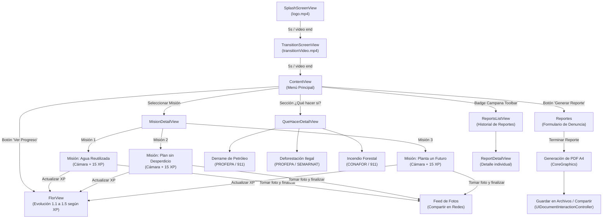

# 🌱 Bloom — Gamificación y Acción Ecológica Ciudadana

<p align="center">
  
  
  
  
  
  
</p>

---

## 📌 Índice

1. [Acerca del Proyecto](#-acerca-del-proyecto)
2. [Características Principales](#-características-principales)
3. [Mecánica de Gamificación (La Flor)](#-mecánica-de-gamificación-la-flor)
4. [Prototipo Interactivo en Figma](#-prototipo-interactivo-en-figma)
5. [Estructura del Proyecto y Código Fuente](#-estructura-del-proyecto-y-código-fuente)
6. [Flujo de Navegación de la Aplicación](#-flujo-de-navegación-de-la-aplicación)
7. [Stack Tecnológico y Frameworks](#-stack-tecnológico-y-frameworks)
8. [Requisitos y Guía de Instalación](#-requisitos-y-guía-de-instalación)
9. [Permisos y Configuración de Hardware](#-permisos-y-configuración-de-hardware)
10. [Recomendaciones para el Repositorio y Roadmap](#-recomendaciones-para-el-repositorio-y-roadmap)
11. [Créditos y Equipo](#-créditos-y-equipo)
12. [Licencia](#-licencia)

---

## 📖 Acerca del Proyecto

**Bloom** es una aplicación móvil nativa para iOS desarrollada por el equipo **LambdaCode** (Universidad de las Américas Puebla - UDLAP). Su objetivo es convertir la conciencia ecológica en **hábitos cotidianos y acciones medibles** mediante técnicas de gamificación, educación cívica y herramientas prácticas para la denuncia ciudadana de delitos ambientales.

En lugar de limitarse a información pasiva, Bloom motiva a los usuarios a realizar acciones reales (como reutilizar agua, evitar el desperdicio de comida o cuidar áreas verdes), capturar evidencia fotográfica, ver crecer una flor virtual como reflejo de su compromiso ecológico y generar reportes oficiales en formato PDF listos para enviar a las autoridades ambientales de México (como PROFEPA y CONAFOR).

---

## ✨ Características Principales

### 1. 🎯 Misiones Ecológicas Prácticas
Misiones enfocadas en hábitos sostenibles de alto impacto:
- **Misión 1: Agua Reutilizada:** Reutilizar agua no potable o residual doméstica para regar plantas, reduciendo el consumo de agua limpia.
- **Misión 2: Plan sin Desperdicio:** Concienciar y actuar contra los más de 1,000 millones de raciones de comida desperdiciadas a nivel mundial diariamente.
- **Misión 3: Planta un Futuro:** Sembrar, cuidar o regar plantas locales para promover la captura de $CO_2$ y purificar el aire.
- **Cámara Integrada:** Validación y registro de misiones mediante captura de fotografía en tiempo real.

### 2. 🌸 Gamificación del Progreso (Bloom Metaphor)
- Acumulación de puntos de experiencia (**XP**), donde cada misión otorga **15 XP**.
- Barra de progreso interactiva hacia la meta de **100 XP**.
- **Metamorfosis botánica:** Una flor virtual evoluciona visualmente en 5 etapas conformadas por sus hitos de experiencia.

### 3. 📸 Feed de Evidencias y Compartir en Redes
- Galería dentro del menú principal donde se registran las fotografías de las misiones concluidas con su fecha correspondiente.
- Integración nativa con `UIActivityViewController` para compartir los logros y fotografías en redes sociales, mensajería (WhatsApp, Telegram) o AirDrop.

### 4. 🚨 Guías de Emergencia Ecológica ("¿Qué hacer si...?")
Protocolos claros, concisos y seguros ante emergencias ecológicas en México, con teléfonos y dependencias oficiales:
- **Derrame de Petróleo en Cuerpos de Agua:** Líneas de atención a PROFEPA (`01-800-770-33-72`) y 911.
- **Deforestación y Tala Ilegal:** Identificación de delitos forestales y reporte a PROFEPA / SEMARNAT.
- **Incendios Forestales:** Medidas de seguridad y reporte inmediato a CONAFOR (`01-800-462-3634`) y 911.

### 5. 📄 Generador y Exportador de Reportes Ciudadanos en PDF
- Formulario de captura de incidencias ambientales (Fecha, Nombre del denunciante, Situación, Descripción detallada).
- Generación de un documento **PDF estándar tamaño A4** utilizando gráficos vectoriales nativos de CoreGraphics.
- Exportación automática mediante `UIDocumentInteractionController` a la app **Archivos (Apple Files)** o compartición inmediata por correo y mensajería.
- Contador y bandeja de reportes emitidos con badge en la barra de navegación (`ReportsListView`).

### 6. 🎬 Experiencia Multimedia de Bienvenida
- `SplashScreenView`: Reproducción automática de video de bienvenida (`logo.mp4`) con `AVPlayer` y transición sin interrupciones.
- `TransitionScreenView`: Transición animada (`transitionVideo.mp4`) hacia el tablero principal.

---

## 🌸 Mecánica de Gamificación (La Flor)

La vista `FlorView` evalúa dinámicamente los puntos de experiencia acumulados en `ProgressManager`:

| Rango de Puntos (XP) | Activo Visual | Estado de la Flor | Significado |
| :--- | :--- | :--- | :--- |
| **0 – 14 XP** | `Flor1.1` | Semilla / Brote Inicial | Comienzo del compromiso ecológico. |
| **15 – 29 XP** | `Flor1.2` | Tallo con primeros brotes | Primera misión completada con éxito. |
| **30 – 44 XP** | `Flor1.3` | Capullo en crecimiento | Hábito ecológico en desarrollo continuo. |
| **45 – 59 XP** | `Flor1.4` | Flor abriéndose | Alto impacto ambiental positivo. |
| **60+ XP** | `Flor1.5` | Flor en Plena Floración | Máximo florecimiento y dominio de hábitos verdes. |

---

## 🎨 Prototipo Interactivo en Figma

El equipo de diseño construyó el flujo interactivo de pantallas, paleta de colores y componentes en Figma. Puedes interactuar con el prototipo navegable directamente a través del siguiente enlace:

👉 **[Ver Prototipo Interactivo en Figma de Bloom (LambdaCode)](https://www.figma.com/proto/pylkfSquMMoNQoMEqRf6yG/LAMBDA-CODE?node-id=45-4&p=f&t=oeTBaVYMaANplC8Y-1&scaling=scale-down&content-scaling=fixed&page-id=0%3A1&starting-point-node-id=26%3A8&show-proto-sidebar=1)**

El repositorio incluye el archivo [`Prototype`](Prototype) con este enlace para fácil referencia.

---

## 📁 Estructura del Proyecto y Código Fuente

El código fuente de la aplicación se encuentra estructurado directamente en la raíz del repositorio:

```text
LAMBDACODE-Bloom/
├── .gitignore                             # Reglas de exclusión de Git para Xcode
├── README.md                              # Documentación completa del proyecto
├── ARCHITECTURE.md                        # Documentación técnica de arquitectura
├── LICENSE                                # Licencia CC0 1.0 Universal (Dominio Público)
├── Prototype                              # Enlace al prototipo interactivo de Figma
├── Bloom.xcodeproj                        # Configuración del proyecto de Xcode (iOS Target 17.5+)
├── Icono.png                              # Isotipo representativo de Bloom
├── Flor1/                                 # Fases gráficas de crecimiento de la flor (30.png a 33.png)
├── Menu/                                  # Código fuente en Swift y Assets
│   ├── BloomApp.swift                     # Entrada principal (@main) de la app con StateObject global
│   ├── MenuApp.swift                      # Estructura previa de entrada (histórico de desarrollo)
│   ├── ProgressManager.swift              # Gestor de estado observable (puntos, misiones, fotos, reportes)
│   ├── SplashScreenView.swift             # Pantalla inicial con reproducción de video de logo
│   ├── TransitionScreenView.swift         # Pantalla de transición animada
│   ├── ContentView.swift                  # Dashboard central: Misiones, Feed de fotos, Guías y Reportes
│   ├── FlorView.swift                     # Vista de progreso visual con las 5 etapas de la flor
│   ├── MisionDetailView.swift             # Vista previa e inscripción a misiones
│   ├── DenunciarContaminaciónView.swift # Implementación Misión 1: "Agua reutilizada"
│   ├── ReforestaciónView.swift          # Implementación Misión 2: "Plan sin desperdicio"
│   ├── MonitorearAguaView.swift          # Implementación Misión 3: "Planta un futuro"
│   ├── QueHacerView.swift                 # Guías de contingencia ambiental (petróleo, tala, incendios)
│   ├── GuiaView.swift                     # Guías adicionales de acción ciudadana
│   ├── Reportes.swift                     # Formulario y generador vectorial de reportes PDF en A4
│   ├── ReportsList.swift                  # Historial y detalle individual de reportes generados
│   ├── ImagePicker.swift                  # Puente UIKit (UIImagePickerController) para captura de fotos
│   ├── Assets.xcassets/                   # Conjunto de imágenes, colores e iconos de la app
│   ├── logo.mp4                           # Video de bienvenida
│   └── transitionVideo.mp4                # Video de transición
├── MenuTests/                             # Suite de pruebas unitarias
└── MenuUITests/                           # Suite de pruebas de interfaz de usuario
```

> [!NOTE]
> **Aclaración sobre Nombres de Archivo de Misiones:**
> Durante el proceso ágil de desarrollo, se reasignaron los objetivos de las misiones:
> - `DenunciarContaminaciónView.swift` contiene la lógica y UI de **"Agua Reutilizada"** (Misión 1).
> - `ReforestaciónView.swift` contiene la lógica y UI de **"Plan sin Desperdicio"** (Misión 2).
> - `MonitorearAguaView.swift` contiene la lógica y UI de **"Planta un Futuro"** (Misión 3).
> 
> La función `destinationView(for:)` en `MisionDetailView.swift` gestiona este enrutamiento de forma transparente.

---

## 🗺️ Flujo de Navegación de la Aplicación



---

## 🛠️ Stack Tecnológico y Frameworks

| Módulo / Función | Tecnología / Framework | Propósito en el Código |
| :--- | :--- | :--- |
| **Lenguaje** | `Swift 5.0` | Lenguaje nativo de desarrollo para ecosistema Apple. |
| **Interfaz de Usuario** | `SwiftUI` | Declaración de pantallas reactivas, listas, scroll horizontal y animaciones. |
| **Gestión de Estado** | `@EnvironmentObject`, `ObservableObject`, `@Published` | Distribución global de XP, misiones completadas y lista de reportes en `ProgressManager`. |
| **Reproducción de Video** | `AVKit` / `AVFoundation` | Controladores `AVPlayer` y `AVPlayerViewController` para Splash y Transición. |
| **Captura Fotográfica** | `UIKit` (`UIImagePickerController`) | Integración con la cámara nativa mediante `UIViewControllerRepresentable` en `ImagePicker`. |
| **Generación de Documentos** | `CoreGraphics` & `PDFKit` | Dibujo vectorial programático y maquetado de páginas A4 en memoria (`UIGraphicsBeginPDFContextToData`). |
| **Intercambio y Archivos** | `UIDocumentInteractionController` & `UIActivityViewController` | Guardar PDFs generados en la app Archivos de iOS y compartir fotos/documentos. |
| **Pruebas** | `XCTest` | Infraestructura de pruebas unitarias y de UI automatizadas. |

---

## 🚀 Requisitos y Guía de Instalación

### Requisitos del Sistema
- Mac con procesador Apple Silicon (M1/M2/M3/M4) o Intel.
- macOS Sonoma 14.0 o superior.
- **Xcode 15.0 o posterior** instalado.
- Dispositivo físico con iOS 17.5+ (o Simulador de Xcode con iOS 17.5+).

### Paso a Paso para Ejecutar el Proyecto

1. **Clonar el repositorio:**
   ```bash
   git clone https://github.com/AngelGab3/LAMBDACODE-Bloom.git
   cd LAMBDACODE-Bloom
   ```

2. **Abrir en Xcode:**
   ```bash
   open Bloom.xcodeproj
   ```
   O bien haz doble clic directamente en `Bloom.xcodeproj` desde el Finder.

4. **Configurar Firma y Equipo (Signing & Capabilities):**
   - En el navegador de proyectos de Xcode (panel izquierdo), selecciona el proyecto raíz `Bloom`.
   - Dirígete a la pestaña **Signing & Capabilities**.
   - En **Team**, selecciona tu cuenta de desarrollador personal (o de Apple Developer Program).
   - Ajusta el **Bundle Identifier** si es necesario (por defecto `lambdacode`).

5. **Compilar y Ejecutar:**
   - Selecciona un simulador de iPhone (por ejemplo, *iPhone 15 Pro*) o tu dispositivo físico conectado.
   - Presiona `Cmd + R` o haz clic en el botón **Play / Run**.

---

## 🔒 Permisos y Configuración de Hardware

Para que la app funcione correctamente en un dispositivo físico, el archivo `Info.plist` (o los Target Properties en Xcode) debe contar con las siguientes descripciones de uso:

- **`NSCameraUsageDescription` (`Privacy - Camera Usage Description`):**
  > *"Bloom requiere acceso a tu cámara para que puedas tomar y subir fotos de evidencia al completar tus misiones ecológicas."*
- **`NSPhotoLibraryAddUsageDescription` (`Privacy - Photo Library Additions Usage Description`):**
  > *"Bloom requiere permiso para guardar las fotografías de tus misiones en tu carrete fotográfico."*

> [!TIP]
> En el Simulador de Xcode no se dispone de una cámara física por defecto. Para probar la captura de fotos sin un dispositivo real, se recomienda ejecutar en un iPhone físico o configurar una imagen simulada en el menú *Hardware* del Simulador.

---

## 💡 Recomendaciones para el Repositorio y Roadmap

Para elevar la calidad del repositorio a estándares de producción y facilitar la colaboración abierta:

1. **Persistencia de Datos:**
   Actualmente `ProgressManager` almacena el estado en memoria RAM durante la sesión. Se recomienda incorporar `@AppStorage`, `UserDefaults`, `SwiftData` o `CoreData` para que los puntos, misiones y fotos persistan entre reinicios de la aplicación.
2. **Geolocalización Automática:**
   Integrar el framework `CoreLocation` en la vista `Reportes` para que al levantar una denuncia de derrame o deforestación, se capturen automáticamente las coordenadas GPS del incidente.
3. **Renombrar archivos de Vistas:**
   Refactorizar los nombres de archivo de las misiones (`DenunciarContaminacionView.swift` $\rightarrow$ `MisionAguaReutilizadaView.swift`, etc.) para que coincidan unívocamente con su contenido visual.

---

## 👥 Créditos y Equipo

Proyecto desarrollado por el equipo **LambdaCode**:

- **Ángel Gabriel Munguía Vázquez** — [*@AngelGab3*](https://github.com/AngelGab3) (UDLAP)
- **Verónica Velázquez Bonilla** — Desarrollo y arquitectura SwiftUI
- **Amy Marianee Ramírez Sánchez** — Diseño UI/UX y prototipado

---

## 📄 Licencia

Este proyecto está publicado bajo la licencia **Creative Commons CC0 1.0 Universal (Public Domain Dedication)**. Consulta el archivo [`LICENSE`](LICENSE) para más detalles. Eres libre de usar, estudiar, modificar y distribuir este proyecto sin restricciones.
